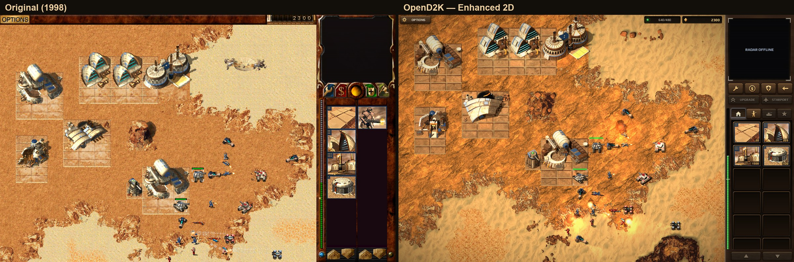
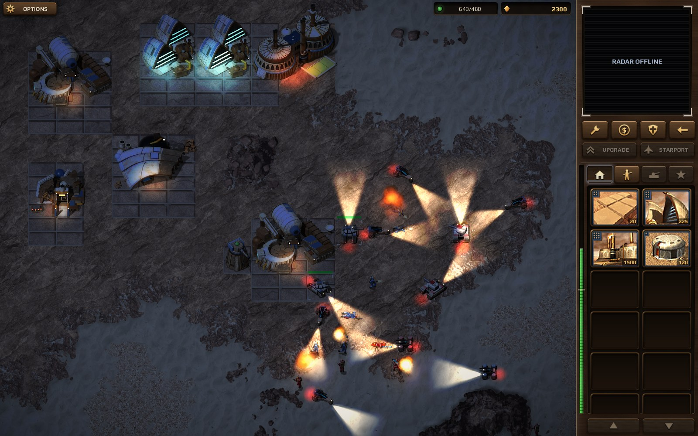
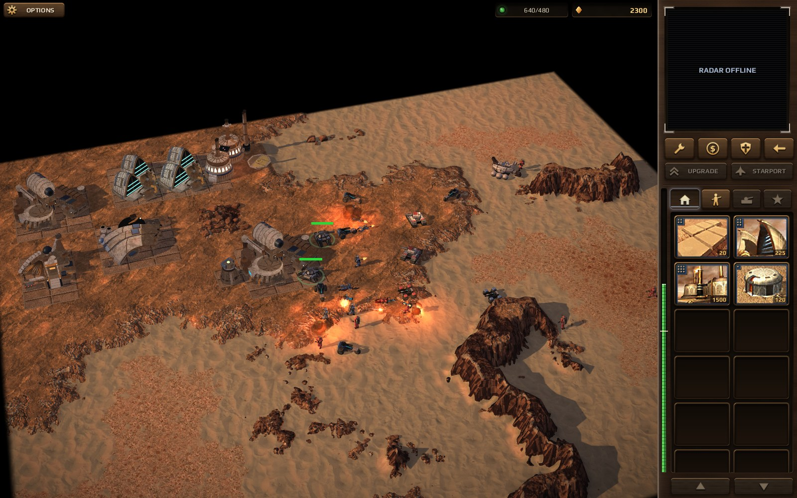

# OpenD2K

**OpenD2K is a native, open-source rebuild of the original *Dune 2000* (Westwood, 1998)** for macOS,
Windows, Linux, Android and iPad / iPhone. It plays the original game, from the original game files, with the
original rules: the game logic is reimplemented in modern C++ (C++20, SDL3) from a study of the original
executable, down to its random-number calls and known quirks, so missions, the AI, the economy and
combat behave as they did in 1998. On top of that come optional modern graphics, a 3D battlefield and
quality-of-life features, each behind a setting.

> **Not OpenRA.** OpenRA's Dune 2000 mod (called "d2k") is a separate project with its own engine and
> rules. OpenD2K is a faithful rebuild of the original game itself.

> **You need your own copy of Dune 2000.** OpenD2K contains no game data. The free community
> *Gruntmods Edition* installer works directly, on every platform — no Windows or Wine needed to unpack it.

Current release: **0.0.1** (the first public release, see [CHANGELOG.md](CHANGELOG.md)).
Downloads: [Releases](https://github.com/OpenD2K/opend2k/releases) · Bugs: [Issues](https://github.com/OpenD2K/opend2k/issues) ·
Ideas and questions: [Discussions](https://github.com/OpenD2K/opend2k/discussions)

## Screenshots


*Left: the original 1998 graphics (Graphics: Original; Dune 2000 art © Westwood Studios / Electronic Arts, shown
for comparison). Right: the same battle in OpenD2K's Enhanced 2D mode with the redesign art pack.*


*Enhanced 2D at night: Modern lighting, lamps and building lights, redesigned art pack.*


*Graphics: 3D at dusk: terrain relief, sun shadows, the redesigned 3D models.*

## Features

- **The original game, faithfully** (*Graphics: Original*): all three campaigns with the original
  campaign map, briefings and scoring, skirmish against the original computer player, the original menus
  and in-game interface, original controls, sounds, music and cutscenes (PC VQA movies, or the PlayStation
  versions from a disc image). Pixel-exact sprites and the original sidebar at an integer scale.
- **Enhanced 2D** (*Graphics: Enhanced*, the default for new players): a modern interface, high-quality
  sprite scaling or replacement art packs, soft shroud, health bars and a "classic view" key (Tab) that
  shows the 1998 graphics while held.
- **3D mode** (*Graphics: 3D*): a 2.5D battlefield with terrain relief, sun light and shadows, a rotating and
  tilting camera, animated 3D models for units and buildings — Metal, Direct3D 12 or Vulkan.
- **Modern effects** (optional): new weapon effects, building destruction, refinery processing, harvest dust,
  spice blooms, damage smoke.
- **Faithful terrain** (optional): designed terrain with modelled cliffs and CC0 materials that follows each
  map's own layout, in Enhanced 2D and in 3D.
- **Redesigned models** (separate download, see below): new 3D models for the units and buildings and the
  2D sprites rendered from them. The first versions are simple; high-detail redesigns are ongoing.
- **Original or modern controls**, extended production queues, factory rally points, game speed and other
  quality-of-life options — every non-original feature can be switched off. An optional cheat menu.
- **Save anywhere**: complete save games (battles and the campaign map) that continue bit-identically.
- **Community content**: Gruntmods community campaigns and custom missions, including the community
  patch's extended mission events. Play any mission as any side.
- **Time of day and lighting** (optional, Enhanced and 3D): dawn, dusk, night or a day–night cycle, modern
  lighting with lamps and headlights at night, HDR rendering and HDR displays, quality settings.
- **Languages**: English, French, German, Spanish (from the game data), and Russian (the PC translation or
  the Russian PlayStation dub).
- **Android, iPad and iPhone**: touch controls and a phone layout. Android: a sideloaded APK. iPad / iPhone:
  built from source and installed with your own Apple ID ([docs/ios.md](docs/ios.md)).

## Getting the game data

1. Download the free **Dune 2000 Gruntmods Edition** installer (`Dune 2000 Gruntmods Edition 1.6.7.exe`)
   from [gruntmods.com](https://gruntmods.com). Optional: the cutscene installers for the movies, from
   [Cutscenes and extra content](https://gruntmods.com/cutscenes-and-extra-content).
2. Start OpenD2K. When it finds no game, it shows the data page: **Choose installer (.exe)…** and pick the
   installer. OpenD2K unpacks it itself (nothing is executed) into its own application-data folder.
   An existing installation works too (**Choose folder…** → the `Dune 2000` folder that contains `data`).
   The cutscene installers are chosen the same way.

OpenD2K also finds a game folder placed next to it and the usual install locations; see
[docs/building.md](docs/building.md#first-start-game-data).

## Install and run

Downloads are on the [Releases](https://github.com/OpenD2K/opend2k/releases) page.

**macOS 11 or later** (Apple Silicon and Intel): `OpenD2K-0.0.1-macos-universal.zip`. Unzip and move
`OpenD2K.app` to Applications. The app is not notarised by Apple, so the first start is blocked: open
*System Settings → Privacy & Security* and click **Open Anyway** (or run
`xattr -dr com.apple.quarantine /Applications/OpenD2K.app` once).

**Windows 10 (1903) / 11, x64**: `OpenD2K-0.0.1-windows-x64.zip`. Unzip anywhere and start
`OpenD2K.exe` (`d2k.exe` is the same program with a console window and the command-line options).
SmartScreen may warn about an unknown publisher: *More info → Run anyway*.

**Linux x86-64** (glibc 2.38 and libstdc++ of GCC 13 or newer: Ubuntu 24.04, Debian 13, Fedora 39 or later):
`OpenD2K-0.0.1-linux-x86_64.tar.gz`. Unpack and run `./d2k` in the folder. Needs X11 or Wayland, and
Vulkan drivers for the 3D mode. The file pickers use the desktop portal or `zenity`; without them start
with `./d2k --install-from "Dune 2000 Gruntmods Edition 1.6.7.exe"` or `./d2k --data DIR`.

**Android 8.0 or later** (arm64 / x86_64): `OpenD2K-0.0.1-android.apk`. Open the file on the device and allow
your browser or file manager to *install unknown apps* when Android asks (the APK is not on Google Play).
In the game, **Choose installer (.exe)…** picks the Gruntmods installer from Downloads. Updating: install the
newer APK over the old one (settings, saves and the game data are kept).

**iPad / iPhone (iPadOS / iOS 17+)**: no App Store version. Two ways:
- **Sideload the unsigned IPA** `OpenD2K-0.0.1-ios-unsigned.ipa`: sign and install it with
  [AltStore](https://altstore.io) / [SideStore](https://sidestore.io) or [Sideloadly](https://sideloadly.io) using a
  (free) Apple ID, or install it with [TrollStore](https://github.com/opa334/TrollStore) on the iOS versions it
  supports. With a free Apple ID the app expires after **7 days** and must be re-signed (AltStore / SideStore
  refresh it; your data and saves stay), and at most 3 sideloaded apps can be active at a time.
- **Build it from source** with Xcode and install it with your own Apple ID.

Both: [docs/ios.md](docs/ios.md). Game data: copy the Gruntmods installer `.exe` into *Files → On My iPad / iPhone →
OpenD2K* (or drag it onto OpenD2K in Finder's device "Files" tab), then tap **Unpack** on the data page.

Settings, saves and the unpacked game live in `~/Library/Application Support/d2k-mac/Dune 2000/` (macOS),
`%APPDATA%\d2k-mac\Dune 2000\` (Windows), `~/.local/share/d2k-mac/Dune 2000/` (Linux) or the app's own storage
(Android, iOS).

### Updating

**Options → Updates** shows whether a newer OpenD2K is out (it asks GitHub when you open Options — never at
startup — and the switch "Check for updates when Options opens" turns that off). **Download** opens the file for
your system in the browser; the game does not replace itself. To update, replace the app (or unpack the new zip
anywhere — the old folder can be deleted). Everything the game keeps — settings, saves, the game data unpacked from
the installer, imported cutscenes and voices, the downloaded art pack — is in the settings folder above, not in
the app, so nothing has to be downloaded or imported again. If the game data folder you picked was next to the old
app and is gone, the game looks again in the usual places (next to the new app, the unpacked installer copy …) and
asks only when it finds nothing. The art pack is downloaded again only when a new pack version is published.

### The redesigned art pack

`OpenD2K-redesign-pack-0.0.1.zip` holds the redesigned 3D models and the sprites rendered from them (~580 MB).
**Easiest: Options → Art pack → Download** in the game (also offered on the Graphics page's 3D tab). The game
fetches it from this repository's GitHub release, checks its SHA-256, installs it into the settings folder's
`artpacks/` and selects it. It looks for a newer pack only when you open Options (switch that off on the same
page) and downloads nothing unless you press Download; the only data sent is a standard web request.

By hand: download the zip from the release page and unzip it into an `artpacks` folder next to the program or in
the settings folder above (the zip contains the folder `opend2k-redesign/`, so you get
`artpacks/opend2k-redesign/pack.ini`). On Linux the in-game download needs libcurl (`libcurl4`, installed on most
desktops); without it the page links to the release. Then:
- 2D: Options → Graphics → *Custom* → **Art: opend2k-redesign** (the Enhanced and 3D presets keep it);
- 3D: **3D models: New (art pack)** uses the installed pack.

Without the pack, Enhanced uses the original sprites and 3D shows the built-in models and sprites.

## Controls

The original mouse scheme is the default (Options → Controls: Original / Modern). The most useful keys:

| Input | Action |
|---|---|
| Left click / drag | select units; with units selected: move, attack (Original scheme) |
| Right click | Original: deselect · Modern: move / attack |
| Ctrl + click | force attack (any unit, building or the ground) |
| Alt + click | force move (crushers drive over infantry) |
| S / D | stop / deploy (MCV) |
| Ctrl+1..9 / 1..9 | assign / recall control groups |
| Right drag, arrow keys | scroll the map · mouse wheel: zoom |
| Tab | (Enhanced / 3D) hold to see the original 1998 graphics |
| Esc / P | pause menu |
| **Factory rally point** | select one of your factories (barracks, factories, starport) with no units selected, then Alt + click on the ground (Original) or right click (Modern); new units drive there. The same click on the factory clears it. Options → Factory rally points |
| **Production queue** (Extended, default) | unit icon: left click +1, Shift + left +10, **right click: build forever (∞)**, right click on ∞: stop, Ctrl + right click: one fewer. Options → Production queue: Original for the 1998 behaviour |
| **3D camera** | Q / E rotate, Page Up / Down or Ctrl + wheel tilt, middle drag rotate + tilt, Home reset |

Touch (iPad / iPhone / Android): tap to select / order, two-finger drag to scroll, pinch to zoom, long press for
tooltips. All controls and options: [docs/STATUS.md](docs/STATUS.md).

## Building from source

Short version (every platform, options and packaging in [docs/building.md](docs/building.md)):

```sh
# macOS:   brew install cmake ninja sdl3
# Linux:   compiler, CMake, Ninja + SDL3's build dependencies (docs/building.md)
# Windows: Visual Studio 2022 "Desktop development with C++", then use the "x64 Native Tools Command Prompt"
cmake -S . -B build -G Ninja -DCMAKE_BUILD_TYPE=Release
cmake --build build
```
Then run `build/Dune 2000.app` (macOS; `-DD2K_APP_NAME=OpenD2K` names it `OpenD2K.app`), `build\OpenD2K.exe`
(Windows) or `build/d2k` (Linux). SDL3 is downloaded and built automatically when it is not installed.
iPad / iPhone: [docs/ios.md](docs/ios.md). Android: [docs/android.md](docs/android.md). Release packages: `tools/release/package_{macos,linux,windows,android}.sh`.

Tests: `ctest --test-dir build` (the tests that need the original data are skipped without it).

## Status and roadmap

The original single-player game is complete and playable: campaigns, skirmish, AI, saves, all original
screens. What works, every option and the controls: [docs/STATUS.md](docs/STATUS.md).

Next:
- **0.0.2**: a real fire effect for burning buildings, redesigned working animations for the buildings (factory
  cranes, research centre and starport lights, refinery and wind trap parts) in Enhanced and 3D, fixes from your
  reports, Android improvements.
- **Later**: high-detail redesigned models for every unit and building; multiplayer (LAN, then internet, replays);
  shadows from lamps and fires; incremental art pack updates; and finally a new Emperor campaign in the style of
  the original ones.

Ideas are welcome in [Discussions](https://github.com/OpenD2K/opend2k/discussions); bugs go to
[Issues](https://github.com/OpenD2K/opend2k/issues) (see [CONTRIBUTING.md](CONTRIBUTING.md)).

## How it was made

The game logic was reimplemented by studying the original executable (disassembled and decompiled with
Ghidra) and writing new code that behaves the same — no original code or data is included in this
repository. Source comments name the original functions and addresses they correspond to. The file
formats are described in [docs/formats.md](docs/formats.md). The 3D models are our own, built by the
procedural Blender scripts in `tools/models/`.

OpenD2K was built with heavy help from AI: the owner directed and play-tested it, and Claude Code (Anthropic's AI
coding assistant) did most of the reverse engineering, programming and the Blender scripts that generate the 3D
models. No original game assets are included or copied.

## Credits

*Dune 2000* was made by **Westwood Studios** (1998, published by Electronic Arts); OpenD2K exists out of love for it.
OpenD2K stands on the work of the Dune 2000 community:

- **FunkyFr3sh** and the **CnCNet** patch authors (hifi, Sonarpulse, mvi, CCHyper and others) — the Dune 2000
  community patches ([dune2000-sp-patches](https://github.com/FunkyFr3sh/dune2000-sp-patches),
  [CnCNet/d2k-patches](https://github.com/CnCNet/d2k-patches)), whose symbol table and structure layouts were an
  invaluable map of the original executable (used as reference only; none of their code is included).
- **jkoncick** — the [D2kEditor](https://github.com/jkoncick/D2kEditor) map and mission editor (MIT), the
  reference for the mission, map and rules file formats.
- **Gruntmods** — the Gruntmods Edition of Dune 2000, its community campaigns and the cutscene installers.
- The Dune 2000 community at CnCNet, FED2K and Gruntmods for decades of documentation, patches and missions.
- [ambientCG](https://ambientcg.com) and [Poly Haven](https://polyhaven.com) — the CC0 terrain textures and rock
  scans of the designed terrain ([assets/terrain/LICENSES.md](assets/terrain/LICENSES.md)).
- Preview images that show the original 1998 art (the watermarked pictures in `assets/previews`, shown on the
  Graphics and welcome pages, and the left half of `docs/media/original-vs-enhanced.jpg`) are screenshots of *Dune 2000* © Westwood Studios / Electronic Arts, shown for
  comparison; they are not covered by OpenD2K's licences ([assets/LICENSES.md](assets/LICENSES.md)).

Libraries ([third_party/LICENSES.md](third_party/LICENSES.md)): [SDL3](https://libsdl.org) (zlib licence;
downloaded at build time when not installed), the LZMA SDK decoder by Igor Pavlov (public domain),
[stb_truetype / stb_image](https://github.com/nothings/stb) by Sean Barrett (public domain / MIT),
[cgltf](https://github.com/jkuhlmann/cgltf) by Johannes Kuhlmann (MIT), [zlib](https://zlib.net) (zlib licence), the
[Play](https://fonts.google.com/specimen/Play) font by Jonas Hecksher (SIL Open Font License 1.1).
Tools: [Ghidra](https://ghidra-sre.org) (Apache 2.0) for the analysis, [Blender](https://www.blender.org) for the models.

## Legal

OpenD2K is an unofficial fan project. It is not affiliated with, endorsed by or connected to Electronic Arts,
Westwood Studios, the Herbert estate or any rights holder of *Dune* or *Dune 2000*. *Dune* is a trademark of
its respective owners; *Dune 2000* and all its game data (graphics, sounds, music, movies, text, missions)
are the property of their owners. **This repository and the release packages contain no original game files**,
and the game cannot run without a copy you obtain yourself. (The only original imagery shipped is in a few
watermarked comparison screenshots among the graphics previews, `assets/previews`, and in the README screenshot
`docs/media/original-vs-enhanced.jpg`, both shown for comparison.)

## Licence

OpenD2K is free software: you can redistribute it and/or modify it under the terms of the **GNU General Public
License, version 3 or (at your option) any later version** (`GPL-3.0-or-later`, see [LICENSE](LICENSE)). It comes
with no warranty. Third-party components keep their own licences ([third_party/LICENSES.md](third_party/LICENSES.md));
the shipped 3D models and assets are listed in [assets/LICENSES.md](assets/LICENSES.md).

The downloadable redesign art pack (rendered sprites and 3D models, Options → Art pack) is licensed under
**Creative Commons Attribution-ShareAlike 4.0** (`CC BY-SA 4.0`): share and adapt it with credit to "OpenD2K
contributors" and share changed art under the same licence. The scripts that generate the models are part of this
repository (GPL-3.0-or-later). The original Dune 2000 game data is **not** part of this project — you need your own copy (Gruntmods Edition).
